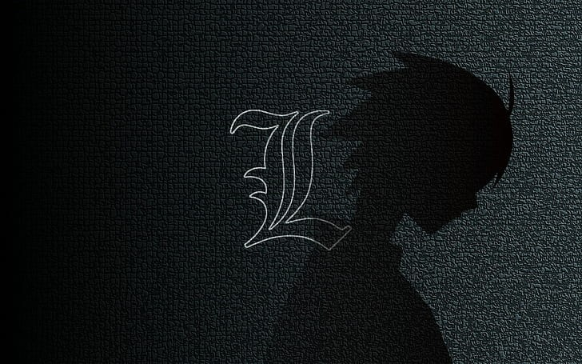

<!-- ============ L LAWLIET x DEATH NOTE | RED EDITION ============ -->


<div align="center">

[+Student;AI+%7C+Python+%7C+Cybersecurity+%7C+Ethical+Hacking)](https://git.io/typing-svg)


</div>

<p align="center"></p>


# 🍰 CASE FILE: LOVE SINGH

```diff
- CLASSIFIED: DETECTIVE PROFILE
+ Name        : Love Singh  (alias: L)
+ Occupation  : B.Tech CSE (AI & ML) Student
+ Role        : Aspiring AI Engineer | Tech Enthusiast
+ Main Case   : Python, Machine Learning, Artificial Intelligence
+ Side Case   : Cybersecurity & Ethical Hacking
+ Interests   : Intelligent Systems, Automation & Security
+ Weakness    : Sweets and an endless curiosity
! Status      : Still investigating. Never closing the case.
```

🔴 Curious mind, creative thinker, and lifelong learner.
🔴 I explore new tech, experiment with ideas, and build projects that solve real-world problems.
🔴 **Currently investigating:** `Python` • `AI/ML` • `Cybersecurity` • `Ethical Hacking`

> *The coder whose bug is written in this file shall be fixed before dawn.* 🍬


# 📡 CONTACT THE DETECTIVE

<p align="left">
  <a href="https://instagram.com/love_singh_aiengr"></a>
  <a href="https://linkedin.com/in/love-singh-bb83ba392"></a>
  <a href="mailto:rajagamerz0007@gmail.com"></a>
</p>


# 🗂️ EVIDENCE: TECH STACK


# 🔴 DETECTIVE RANKINGS

| Skill | Deduction Level |
|:--|:--|
| 🐍 Python | `██████████░░` Advanced beginner, leveling up fast |
| 🤖 AI / ML | `████████░░░░` Actively training |
| 🔐 Cybersecurity | `██████░░░░░░` Investigating |
| 💻 C / DSA | `████████░░░░` Building real projects |
| 🛠️ Arduino / Raspberry Pi | `██████░░░░░░` Tinkering |


# 📊 INVESTIGATION STATS

<div align="center">


<br/>


<br/>


</div>

<p align="center"><br/><sub><b>THE DETECTIVE HIMSELF</b></sub></p>

<div align="center">

### 🍬 *"I'm not just coding. I'm solving the case."* 🍬

</div>


